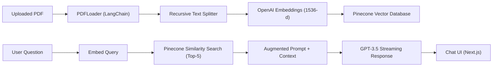

# PDF AI Chatbot — Comprehensive User Manual & Document Guide

A step-by-step guide on how to leverage the **PDF AI Chatbot** for querying, summarizing, and extracting actionable intelligence from various document types using Retrieval-Augmented Generation (RAG).

---

## Table of Contents
1. [Overview & Architecture](#1-overview--architecture)
2. [Quickstart: How to Run & Use the App](#2-quickstart-how-to-run--use-the-app)
3. [Document Guides & Sample Queries](#3-document-guides--sample-queries)
   - [3.1 Resumes & CVs (HR & Recruiting)](#31-resumes--cvs-hr--recruiting)
   - [3.2 Invoices & Financial Receipts (Accounting & Auditing)](#32-invoices--financial-receipts-accounting--auditing)
   - [3.3 Industry & Research Reports (Analytics & Academia)](#33-industry--research-reports-analytics--academia)
   - [3.4 Legal Contracts & NDAs (Legal & Operations)](#34-legal-contracts--ndas-legal--operations)
   - [3.5 Technical Manuals & Specifications (Engineering & Support)](#35-technical-manuals--specifications-engineering--support)
4. [Querying Strategies: How to Ask Great Questions](#4-querying-strategies-how-to-ask-great-questions)
5. [Troubleshooting & Best Practices](#5-troubleshooting--best-practices)

---

## 1. Overview & Architecture

The **PDF AI Chatbot** uses a modern Retrieval-Augmented Generation (RAG) architecture:



1. **Document Ingestion:** The uploaded PDF is parsed, split into 1,000-character chunks with a 200-character overlap to preserve semantic context across chunk boundaries.
2. **Vector Storage:** Each chunk is converted into high-dimensional vector embeddings and stored in your Pinecone index.
3. **Retrieval & Inference:** When you ask a question, the app finds the top 5 most relevant chunks and feeds them directly into the LLM prompt to generate an accurate, grounded answer.

---

## 2. Quickstart: How to Run & Use the App

### Step 1: Launch the Dev Server
From your project directory:
```bash
cd C:\ag-prg\pdf-chatbot
npm run dev
```
Open your browser at **[http://localhost:3000](http://localhost:3000)**.

### Step 2: Upload Your Document
1. Drag and drop your `.pdf` file into the upload zone (or click to browse).
2. Click **"Upload & Index PDF"**.
3. Wait for the green notification: *"PDF successfully indexed! You can now ask questions."*

### Step 3: Chat with Your Document
- Type questions in the bottom input bar and press **Enter** or click the **Send** button.
- The assistant streams responses token-by-token in real-time.
- To switch documents at any time, click the **"Upload New PDF"** button in the header.

---

## 3. Document Guides & Sample Queries

### 3.1 Resumes & CVs (HR & Recruiting)
Use the chatbot as an automated technical screener to rapidly evaluate candidates against job descriptions.

* **Sample Document:** [`sample-documents/resume_alex_chen.pdf`](file:///C:/ag-prg/pdf-chatbot/sample-documents/resume_alex_chen.pdf)
* **Sample Document:** [`sample-documents/resume_priya_sharma.pdf`](file:///C:/ag-prg/pdf-chatbot/sample-documents/resume_priya_sharma.pdf)

#### Recommended Questions:
- **Skill Verification:** *"Does this candidate have experience with Next.js and TypeScript, and in what context?"*
- **Impact & Metrics:** *"What quantifiable achievements or latency optimizations did the candidate deliver?"*
- **Leadership & Seniority:** *"Did this candidate lead any teams or mentor junior developers?"*
- **Career Timeline:** *"Summarize the candidate's career progression from their earliest role to their present position."*
- **Education & Credentials:** *"What degree and GPA did the candidate graduate with?"*

---

### 3.2 Invoices & Financial Receipts (Accounting & Auditing)
Extract financial line items, due dates, billing details, and tax breakdowns without manual data entry.

* **Sample Document:** [`sample-documents/invoice_apex_digital_services.pdf`](file:///C:/ag-prg/pdf-chatbot/sample-documents/invoice_apex_digital_services.pdf)

#### Recommended Questions:
- **Financial Totals:** *"What is the subtotal, sales tax percentage and amount, and final total due?"*
- **Due Dates & Terms:** *"What are the payment terms (e.g., Net 30) and exact due date?"*
- **Itemized Breakdown:** *"List each itemized service, description, and charge in bullet points."*
- **Remittance Information:** *"What are the bank account number, wire routing code, and remittance notes?"*
- **Vendor & Client Details:** *"Who issued this invoice and who is the billing contact?"*

---

### 3.3 Industry & Research Reports (Analytics & Academia)
Summarize complex 20-50 page industry studies, whitepapers, or scientific papers in seconds.

* **Sample Document:** [`sample-documents/report_global_renewable_energy_2026.pdf`](file:///C:/ag-prg/pdf-chatbot/sample-documents/report_global_renewable_energy_2026.pdf)

#### Recommended Questions:
- **Executive Synthesis:** *"What are the top 3 executive takeaways from this report?"*
- **Quantitative Trends:** *"What was the gigawatt growth in solar and wind capacity compared to previous periods?"*
- **Geographic Insights:** *"How does the Asia-Pacific (APAC) market compare to North America in terms of investments?"*
- **Policy Recommendations:** *"What specific regulatory or infrastructure changes does the report suggest?"*
- **Methodology:** *"What data sources or analytical models were used to calculate levelized costs?"*

---

### 3.4 Legal Contracts & NDAs (Legal & Operations)
Identify legal risks, liability limitations, non-disclosure durations, and jurisdiction clauses.

* **Sample Document:** [`sample-documents/contract_mutual_nda.pdf`](file:///C:/ag-prg/pdf-chatbot/sample-documents/contract_mutual_nda.pdf)
* **Sample Document:** [`sample-documents/contract_saas_service_agreement.pdf`](file:///C:/ag-prg/pdf-chatbot/sample-documents/contract_saas_service_agreement.pdf)

#### Recommended Questions:
- **Parties & Intent:** *"Who are the entering parties, and what is the stated business purpose?"*
- **Term & Termination:** *"How long do the obligations last, and how many days written notice is required to cancel?"*
- **SLA & Penalties:** *"What uptime percentage is guaranteed, and what service credits apply if downtime occurs?"*
- **Data Rights & Security:** *"Who owns the data, and what encryption standards are mandated?"*
- **Governing Law:** *"Which state or jurisdiction governs disputes under this agreement?"*

---

### 3.5 Technical Manuals & Specifications (Engineering & Support)
Troubleshoot error codes, configure APIs, or lookup hardware specs instantly.

#### Recommended Questions:
- **Step-by-Step Instructions:** *"What are the exact prerequisites and configuration steps to deploy this service?"*
- **Error Diagnostics:** *"What causes error code 403 and how can it be resolved?"*
- **Limits & Constraints:** *"What are the rate limits, payload size maximums, and timeout thresholds?"*

---

## 4. Querying Strategies: How to Ask Great Questions

| Query Type | Less Effective Prompt | Highly Effective Prompt |
| :--- | :--- | :--- |
| **Extraction** | *"Give me the numbers."* | *"Extract the invoice number, total amount due, and due date in bullet points."* |
| **Summarization** | *"Tell me about it."* | *"Summarize Section 2 into 3 concise bullet points focusing on key risks."* |
| **Comparative** | *"Who is better?"* | *"Compare the candidate's backend experience versus their frontend experience."* |
| **Conditional** | *"Is there a penalty?"* | *"Under what specific conditions does the customer qualify for an SLA service credit?"* |

> [!TIP]
> **Keyword Specificity:** Because the vector search indexes semantic meaning, including key terms from the document (like *"Clause 4"*, *"SLA"*, *"Net 30"*, or *"Priya"*) helps the retriever pinpoint the exact chunk faster.

---

## 5. Troubleshooting & Best Practices

### Selectable Text vs. Scanned Documents
* **Supported:** PDFs with selectable, copy-pasteable text (e.g. exported from Word, Google Docs, LaTeX, code editors).
* **Not Supported Out of the Box:** Scanned image-only PDFs or camera photos without an OCR layer. The app will warn you if no readable text is detected.

### Pinecone Index Hygiene
* Each time you upload a new document, its chunks are added to your Pinecone index.
* If you upload multiple completely unrelated documents into the same index without namespaces, the retriever searches across all of them. To start fresh with a single document, clear the index or use the "Upload New PDF" button.

### API Quota Checks
* Ensure your `OPENAI_API_KEY` has active credits in your [OpenAI Dashboard](https://platform.openai.com/settings/organization/billing).
